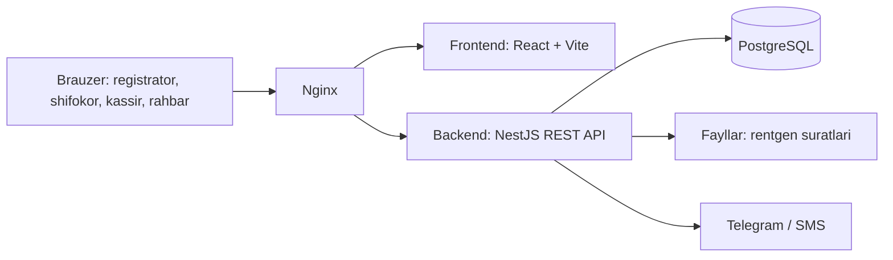
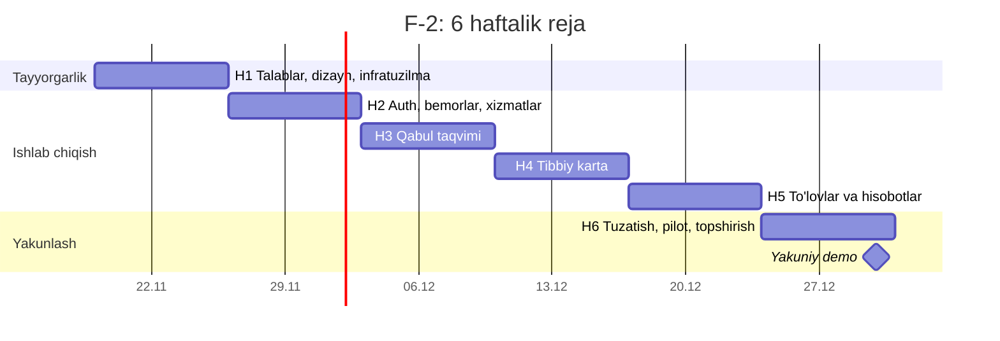

# Stomatologiya klinikasi boshqaruv platformasi (F-2)

Xususiy stomatologiya klinikasi uchun veb-platforma: bemorlar, qabul taqvimi, tish formulasi va tibbiy karta, to'lovlar va hisobotlar bitta tizimda.

| | |
| --- | --- |
| **Muddat** | 19-noyabr – 30-dekabr 2026 (6 hafta) |
| **Jamoa** | 7 kishi |
| **Tasklar** | 65 ta |
| **Yakuniy demo** | 30-dekabr 2026 |
| **Task-treker** | [Reja va tasklar jadvali](https://claude.ai/artifact/LfmxnjN1v4Hhgyz31x4bXt) |
| **Hujjatlar** | [Arxitektura](docs/arxitektura.md) · [API kontrakti](docs/api.md) · [Har a'zo uchun TZ](docs/tz/README.md) |

## Mundarija

1. [Loyiha maqsadi](#1-loyiha-maqsadi)
2. [MVP doirasi](#2-mvp-doirasi)
3. [Tizim foydalanuvchilari](#3-tizim-foydalanuvchilari)
4. [Jamoa va javobgarlik](#4-jamoa-va-javobgarlik)
5. [Texnologiyalar](#5-texnologiyalar)
6. [Arxitektura va repo tuzilmasi](#6-arxitektura-va-repo-tuzilmasi)
7. [6 haftalik reja](#7-6-haftalik-reja)
8. [Tasklar haftalar bo'yicha](#8-tasklar-haftalar-boyicha)
9. [Ish tartibi](#9-ish-tartibi)
10. [Lokal ishga tushirish](#10-lokal-ishga-tushirish)
11. [Xavflar](#11-xavflar)

---

## 1. Loyiha maqsadi

Klinika kundalik ishini qog'oz va Excel'dan bitta tizimga o'tkazish:

- registrator bemorni 1 daqiqada qabulga yozadi va bir vaqtga ikki bemor tushib qolmaydi;
- shifokor bemorning butun tarixini, tish formulasini va davolash rejasini bitta sahifada ko'radi;
- kassir to'lovni qabul qiladi, qarz avtomatik hisoblanadi;
- rahbar kunlik tushum va shifokorlar ulushini bir qarashda ko'radi.

## 2. MVP doirasi

### Kiradi

| Modul | Nima qiladi |
| --- | --- |
| Auth va rollar | Login, 4 ta rol, har rol faqat o'z bo'limlarini ko'radi |
| Xodimlar | Shifokor va xodimlarni qo'shish, bloklash, shifokor ish jadvali |
| Bemorlar | Bemor bazasi, ism va telefon bo'yicha qidiruv |
| Xizmatlar va narxlar | Preyskurant: toifalar, xizmatlar, narxlar |
| Qabul | Taqvim (kun/hafta, shifokor va kreslo bo'yicha), bugungi navbat, statuslar |
| Tibbiy karta | Tish formulasi (32 tish), tashriflar tarixi, davolash rejasi, rentgen fayllari |
| To'lovlar | Kassa, qisman to'lov, qarz, chegirma, chek, shifokor ulushi |
| Hisobotlar | Kunlik tushum, shifokorlar bo'yicha, qarzdorlar, Excel eksport |
| Bildirishnoma | Telegram yoki SMS orqali qabul eslatmasi (ustuvorligi past, vaqt qolsa) |

### Kirmaydi (keyingi versiyaga)

Ombor va materiallar hisobi, laboratoriya buyurtmalari, onlayn to'lov, bemor uchun mobil ilova, bir nechta filial.

## 3. Tizim foydalanuvchilari

| Rol | Kim | Asosiy imkoniyatlar |
| --- | --- | --- |
| `ADMIN` | Klinika rahbari | Hammasi: xodimlar, narxlar, hisobotlar |
| `RECEPTIONIST` | Registrator | Bemorlar, qabul taqvimi, navbat |
| `DOCTOR` | Shifokor | O'z bemorlari, tibbiy karta, tashrif va davolash rejasi |
| `CASHIER` | Kassir | To'lovlar, cheklar, qarzdorlar |

## 4. Jamoa va javobgarlik

| Kim | Rol | Javobgarlik | Tasklar |
| --- | --- | --- | --- |
| Ilyos | PM (+ testda yordam) | Talablar, klinika bilan aloqa, backlog, demolar, qo'llanma | 10 (+5 test) |
| Shoxjahon | Backend-1 (yetakchi) | Arxitektura, DB, auth, qabul, tibbiy karta, to'lovlar | 11 |
| Muhammadyusuf | Backend-2 | Bemorlar, xizmatlar, ish jadvali, hisobotlar, ma'lumot importi | 12 |
| Jahongir | Frontend-1 (yetakchi) | Skelet, login, qabul taqvimi, tish formulasi, kassa | 9 |
| Nurmuhammad | Frontend-2 | Komponentlar, bemorlar, bemor kartasi, hisobotlar | 8 |
| Sanjar | Dizayner | Wireframe, UI kit, barcha ekranlar dizayni, UI tekshiruvi | 7 |
| Diyorbek | QA/DevOps | Repo, CI, serverlar, backup, test-keyslar, regress, pilot | 8 |

## 5. Texnologiyalar

Frontend ham, backend ham **TypeScript**'da: jamoa bir-birining kodini o'qiy oladi va review qila oladi.

| Qatlam | Texnologiya | Nega |
| --- | --- | --- |
| Frontend | React + TypeScript + Vite | Eng ko'p o'quv materiali va tayyor kutubxona |
| UI kutubxona | Ant Design | Jadval, forma, modal, sana tanlash tayyor |
| Taqvim | react-big-calendar (MIT) | Shifokorlar ustun-ustun turadigan kun ko'rinishi bepul (FullCalendar'da bu ko'rinish pullik) |
| Server ma'lumotlari | TanStack Query | Yuklash, kesh va xatolik holatlarini boshqaradi |
| Backend | NestJS | Tayyor tuzilma, guard'lar orqali rollar, Swagger |
| ORM | Prisma 7 | Sxema va migratsiyalar sodda |
| Ma'lumotlar bazasi | PostgreSQL | Bemor, qabul, to'lov o'zaro bog'langan ma'lumot |
| Auth | JWT (access + refresh token) | 4 ta rol uchun yetarli |
| Fayllar | Serverdagi papka (keyin MinIO) | MVP uchun yetarli |
| API hujjati | Swagger / OpenAPI | Frontend va backend o'rtasidagi kelishuv |
| Deploy | Docker Compose + VPS + Nginx | Staging va production bir xil |
| CI/CD | GitHub Actions | Repo bilan birga, bepul |
| Dizayn | Figma | Ant Design'ning tayyor Figma kit'i bor |

> **Prisma versiyasi.** `npm i -D prisma@7` bilan o'rnating. npm'dagi `latest` hozir Prisma 8 ning sinov (rc) versiyasiga ko'rsatadi.

**Ataylab ishlatmaymiz:** mikroservislar, Kubernetes, Redis, GraphQL. Bitta backend, bitta frontend, bitta baza.

## 6. Arxitektura va repo tuzilmasi



Bitta repo (monorepo):

```
.
├── backend/              # NestJS
│   ├── prisma/           # schema.prisma, migratsiyalar
│   ├── prisma.config.ts
│   └── src/
│       ├── common/          # guard'lar, xato formati, telefon, vaqt, parol
│       ├── auth/            # login, JWT, rollar
│       ├── users/           # xodimlar, shifokorlar
│       ├── audit/           # amallar jurnali
│       ├── patients/        # bemorlar
│       ├── catalog/         # xizmatlar va narxlar
│       ├── schedule/        # kreslolar, shifokor ish jadvali
│       ├── appointments/    # qabul
│       ├── visits/          # tashrif, bajarilgan xizmatlar
│       ├── dental-chart/    # tish formulasi
│       ├── treatment-plans/ # davolash rejasi
│       ├── files/           # rentgen va hujjatlar
│       ├── payments/        # to'lovlar, chek
│       ├── reports/         # hisobotlar, shifokor ulushi
│       └── notifications/   # Telegram eslatma
├── frontend/             # React + Vite
│   └── src/
│       ├── pages/        # sahifalar (modul bo'yicha)
│       ├── components/   # umumiy komponentlar
│       ├── api/          # API klient va so'rovlar
│       └── layouts/
├── docs/                 # arxitektura, API kontrakti, TZ'lar, qo'llanma
├── docker-compose.yml
└── README.md
```

Ma'lumotlar bazasi: 16 ta jadval — `User`, `RefreshToken`, `DoctorSchedule`, `Chair`, `Patient`, `ServiceCategory`, `Service`, `Appointment`, `Visit`, `VisitService`, `ToothRecord`, `TreatmentPlan`, `TreatmentPlanItem`, `PatientFile`, `Payment`, `AuditLog`. To'liq sxema: `backend/prisma/schema.prisma`. Maydonlar, cheklovlar va modul egalari: [docs/arxitektura.md](docs/arxitektura.md).

Sxemadagi uchta asosiy qoida:

- **Narx tashrifga nusxalanadi.** Preyskurant o'zgarsa ham eski tashriflar summasi o'zgarmaydi.
- **Qarz saqlanmaydi, hisoblanadi.** To'lov o'chirilmaydi; xato bo'lsa qaytarish (`REFUND`) yoziladi.
- **Tish holati tarix sifatida yoziladi.** Har o'zgarish yangi qator, hozirgi holat — eng oxirgi yozuv.

## 7. 6 haftalik reja

Hafta payshanbadan chorshanbagacha. Har chorshanba — demo.

| Hafta | Sanalar | Maqsad | Hafta oxiridagi natija | Tasklar |
| --- | --- | --- | --- | --- |
| H1 | 19–25 noyabr | Tayyorgarlik: talablar, dizayn asosi, infratuzilma | MVP hujjati, DB sxemasi, wireframe'lar, repo va staging tayyor | 14 |
| H2 | 26 noyabr – 2 dekabr | Asos: login, rollar, bemorlar, xizmatlar, xodimlar | Demo №1: tizimga kirish va bemor qo'shish ishlaydi | 13 |
| H3 | 3–9 dekabr | Qabul taqvimi va navbat | Registrator bemorni qabulga yozadi; klinikaga oraliq ko'rsatuv | 9 |
| H4 | 10–16 dekabr | Tibbiy karta: tish formulasi, tashriflar, davolash rejasi | Demo №2: shifokor tashrifni to'liq yuritadi | 10 |
| H5 | 17–23 dekabr | To'lovlar, kassa, hisobotlar, eslatmalar | Barcha funksiyalar tayyor (feature freeze), to'liq regress | 9 |
| H6 | 24–30 dekabr | Xatolarni tuzatish, production, pilot, topshirish | Klinika tizimda ishlayapti; yakuniy demo 30-dekabr | 10 |



## 8. Tasklar haftalar bo'yicha

Status va o'zgarishlar [task-trekerda](https://claude.ai/artifact/LfmxnjN1v4Hhgyz31x4bXt) yuritiladi; bu yerda boshlang'ich reja. Barcha sanalar 2026-yil.

### H1 · 19–25 noyabr · Tayyorgarlik

| ID | Task | Mas'ul | Muddat | Ustuvorlik |
| --- | --- | --- | --- | --- |
| T-01 | Klinika egasi va administrator bilan intervyu, hozirgi ish jarayonini yozib olish | Ilyos | 21.11 | Yuqori |
| T-02 | MVP doirasini tasdiqlash: nima kiradi, nima kirmaydi | Ilyos | 22.11 | Yuqori |
| T-03 | Rollar va huquqlar jadvali (admin, registrator, shifokor, kassir) | Ilyos | 23.11 | Yuqori |
| T-04 | User story'lar va backlog (har modul uchun) | Ilyos | 25.11 | Yuqori |
| T-05 | Texnologiyalar va arxitekturani tanlash | Shoxjahon | 20.11 | Yuqori |
| T-06 | Ma'lumotlar bazasi sxemasi (ER diagramma) | Shoxjahon | 24.11 | Yuqori |
| T-07 | GitHub repo, branch qoidalari, PR shabloni | Diyorbek | 20.11 | Yuqori |
| T-08 | Backend loyiha skeleti (tuzilma, linter, env, DB ulanishi) | Muhammadyusuf | 23.11 | Yuqori |
| T-09 | Frontend loyiha skeleti (routing, UI kutubxona, API klient) | Jahongir | 23.11 | Yuqori |
| T-10 | API kontrakt formatini kelishish (Swagger/OpenAPI) | Muhammadyusuf | 25.11 | O'rta |
| T-11 | Asosiy ekranlar wireframe'i (qabul taqvimi, bemor kartasi, to'lov) | Sanjar | 23.11 | Yuqori |
| T-12 | UI kit: ranglar, shrift, tugma, forma, jadval | Sanjar | 25.11 | Yuqori |
| T-13 | Bazaviy UI komponentlar (Button, Input, Table, Modal, Select) | Nurmuhammad | 25.11 | O'rta |
| T-14 | Staging server va CI (avtomatik build va deploy) | Diyorbek | 25.11 | Yuqori |

### H2 · 26 noyabr – 2 dekabr · Auth, bemorlar, xizmatlar

| ID | Task | Mas'ul | Muddat | Ustuvorlik |
| --- | --- | --- | --- | --- |
| T-15 | Login, JWT token, parolni almashtirish API | Shoxjahon | 29.11 | Yuqori |
| T-16 | Rollar va huquqlar tekshiruvi (RBAC) | Shoxjahon | 02.12 | Yuqori |
| T-17 | Xodimlar va shifokorlar CRUD API | Muhammadyusuf | 28.11 | Yuqori |
| T-18 | Bemorlar CRUD API + qidiruv (ism, telefon) | Muhammadyusuf | 01.12 | Yuqori |
| T-19 | Xizmatlar va narxlar (preyskurant) API | Muhammadyusuf | 02.12 | Yuqori |
| T-20 | Login sahifasi va himoyalangan sahifalar | Jahongir | 29.11 | Yuqori |
| T-21 | Asosiy layout: yon menyu, header, rolga qarab menyu | Jahongir | 01.12 | Yuqori |
| T-22 | Bemorlar ro'yxati va qo'shish/tahrirlash formasi | Nurmuhammad | 02.12 | Yuqori |
| T-23 | Xizmatlar va narxlar sahifasi | Nurmuhammad | 02.12 | O'rta |
| T-24 | Xodimlar sahifasi (admin uchun) | Jahongir | 02.12 | O'rta |
| T-25 | Dizayn: bemor kartasi va qabul taqvimi (yakuniy) | Sanjar | 30.11 | Yuqori |
| T-26 | Test reja va test-keyslar (auth, bemorlar, xizmatlar) | Diyorbek, Ilyos | 02.12 | O'rta |
| T-27 | Demo №1 va backlogni yangilash | Ilyos | 02.12 | O'rta |

### H3 · 3–9 dekabr · Qabul taqvimi

| ID | Task | Mas'ul | Muddat | Ustuvorlik |
| --- | --- | --- | --- | --- |
| T-28 | Qabul API: yaratish, ko'chirish, bekor qilish, statuslar | Shoxjahon | 06.12 | Yuqori |
| T-29 | Vaqt to'qnashuvini tekshirish (shifokor va kreslo) | Shoxjahon | 08.12 | Yuqori |
| T-30 | Shifokor ish jadvali va kabinet/kreslolar API | Muhammadyusuf | 06.12 | Yuqori |
| T-31 | Qabul taqvimi UI (kun/hafta, shifokor bo'yicha) | Jahongir | 09.12 | Yuqori |
| T-32 | Qabulga yozish oynasi (bemorni qidirish yoki yangi bemor) | Nurmuhammad | 07.12 | Yuqori |
| T-33 | Bugungi navbat ekrani (keldi / kutmoqda / qabulda) | Nurmuhammad | 09.12 | O'rta |
| T-34 | Dizayn: tish formulasi, davolash rejasi, to'lov ekranlari | Sanjar | 07.12 | Yuqori |
| T-35 | Qabul moduli testlari va regress | Diyorbek, Ilyos | 09.12 | Yuqori |
| T-36 | Klinikaga oraliq ko'rsatuv, fikrlarni yig'ish | Ilyos | 09.12 | Yuqori |

### H4 · 10–16 dekabr · Tibbiy karta

| ID | Task | Mas'ul | Muddat | Ustuvorlik |
| --- | --- | --- | --- | --- |
| T-37 | Tish formulasi (odontogramma) API: har tish holati | Shoxjahon | 13.12 | Yuqori |
| T-38 | Tashrif yozuvi API: tashxis, bajarilgan xizmatlar, izoh | Shoxjahon | 16.12 | Yuqori |
| T-39 | Davolash rejasi API (bosqichlar, taxminiy narx) | Muhammadyusuf | 14.12 | O'rta |
| T-40 | Fayl yuklash API (rentgen suratlari) | Muhammadyusuf | 16.12 | O'rta |
| T-41 | Tish formulasi UI (32 tish, interaktiv) | Jahongir | 15.12 | Yuqori |
| T-42 | Bemor kartasi: tashriflar tarixi, davolash rejasi, fayllar | Nurmuhammad | 16.12 | Yuqori |
| T-43 | Shifokor ish stoli: bugungi bemorlar, tashrifni yakunlash | Jahongir | 16.12 | Yuqori |
| T-44 | Dizayn: dashboard, hisobotlar, bo'sh va xatolik holatlari | Sanjar | 14.12 | O'rta |
| T-45 | Tibbiy karta testlari va regress | Diyorbek, Ilyos | 16.12 | Yuqori |
| T-46 | Demo №2 va qolgan ishlarni qayta rejalash | Ilyos | 16.12 | O'rta |

### H5 · 17–23 dekabr · To'lovlar va hisobotlar

| ID | Task | Mas'ul | Muddat | Ustuvorlik |
| --- | --- | --- | --- | --- |
| T-47 | To'lovlar API: hisob, qisman to'lov, qarz, chegirma | Shoxjahon | 21.12 | Yuqori |
| T-48 | Shifokor ulushi (foiz) hisob-kitobi API | Muhammadyusuf | 20.12 | O'rta |
| T-49 | Hisobotlar API: kunlik tushum, shifokor bo'yicha, qarzdorlar | Muhammadyusuf | 23.12 | Yuqori |
| T-50 | Kassa UI: to'lov qabul qilish, chek chop etish | Jahongir | 22.12 | Yuqori |
| T-51 | Dashboard va hisobotlar UI (grafiklar, Excel eksport) | Nurmuhammad | 23.12 | Yuqori |
| T-52 | Telegram yoki SMS orqali qabul eslatmasi | Shoxjahon | 23.12 | Past |
| T-53 | Dizayn tekshiruvi (UI review) va tuzatishlar ro'yxati | Sanjar | 21.12 | O'rta |
| T-54 | To'liq regress test va xatolar ro'yxati | Diyorbek, Ilyos | 23.12 | Yuqori |
| T-55 | Foydalanuvchi qo'llanmasi (har rol uchun qisqa yo'riqnoma) | Ilyos | 23.12 | O'rta |

### H6 · 24–30 dekabr · Yakunlash

| ID | Task | Mas'ul | Muddat | Ustuvorlik |
| --- | --- | --- | --- | --- |
| T-56 | Xatolarni tuzatish (backend) | Shoxjahon | 27.12 | Yuqori |
| T-57 | Xatolarni tuzatish (frontend) | Jahongir | 27.12 | Yuqori |
| T-58 | Ruxsatlar va xavfsizlik tekshiruvi, amallar jurnali (audit log) | Muhammadyusuf | 26.12 | Yuqori |
| T-59 | Planshet/mobil moslashuvi va UI sayqallash | Nurmuhammad | 27.12 | O'rta |
| T-60 | Production server, domen, SSL, kunlik backup | Diyorbek | 26.12 | Yuqori |
| T-61 | Klinikaning boshlang'ich ma'lumotlarini kiritish (xizmatlar, xodimlar, bemorlar) | Muhammadyusuf | 28.12 | Yuqori |
| T-62 | Klinikada pilot sinov (2–3 kun haqiqiy ish) | Diyorbek, Ilyos | 29.12 | Yuqori |
| T-63 | Klinika xodimlarini o'qitish | Ilyos | 29.12 | Yuqori |
| T-64 | Demo taqdimot va ekran rasmlari | Sanjar | 29.12 | O'rta |
| T-65 | Yakuniy demo va loyihani topshirish | Ilyos | 30.12 | Yuqori |

## 9. Ish tartibi

### Uchrashuvlar

| Nima | Qachon | Kim | Maqsad |
| --- | --- | --- | --- |
| Kunlik standup | Har kuni, 15 daqiqa | Hamma | Kecha nima qildim, bugun nima qilaman, nima to'sqinlik qilyapti |
| Haftalik demo | Har chorshanba | Hamma (+ klinika vakili) | Haftalik natijani staging'da ko'rsatish |
| Haftalik rejalash | Demodan keyin, 30 daqiqa | Hamma | Keyingi hafta tasklarini aniqlashtirish |

Vaqtlarni jamoa birinchi kuni kelishib oladi va shu jadvalga yozadi.

### Task statuslari

`Boshlanmagan` → `Jarayonda` → `Tekshiruvda` (PR ochilgan) → `Bajarildi` (merge bo'lgan va staging'da ishlayapti).

Statusni task egasining o'zi shu kuni yangilaydi.

### Git qoidalari

- `main` himoyalangan: to'g'ridan-to'g'ri push yo'q, faqat Pull Request orqali.
- Har task uchun alohida branch: `feature/T-18-patients-api`, `fix/T-56-payment-rounding`.
- Commit xabari task raqami bilan boshlanadi: `T-18: bemorlarni telefon bo'yicha qidirish`.
- PR kichik bo'lsin: bitta task — bitta PR. Katta taskni bo'laklab yuboring.
- Har PR ni kamida bitta kishi ko'radi: backend PR'ni ikkinchi backendchi, frontend PR'ni ikkinchi frontendchi.
- PR 24 soat ichida ko'rib chiqiladi.
- Konflikt bo'lmasligi uchun har kuni ish boshida `main`dan yangilang.

### Task "Bajarildi" deyilishi uchun (Definition of Done)

- [ ] Jadvaldagi qabul mezoni bajarilgan
- [ ] Kod review'dan o'tgan va `main`ga merge bo'lgan
- [ ] CI yashil (build va linter xatosiz)
- [ ] Staging'da ishlayapti
- [ ] Backend uchun: endpoint Swagger'da ko'rinadi, ruxsatlar tekshirilgan
- [ ] Frontend uchun: dizaynga mos, yuklanish va xatolik holatlari ko'rsatilgan
- [ ] QA tekshirgan, kritik xato yo'q

### Frontend va backend qanday kelishadi

1. Backendchi endpoint'ni avval Swagger'da tasvirlaydi (so'rov va javob shakli).
2. Frontendchi shu shakl bo'yicha ishni boshlaydi, backend tayyor bo'lguncha soxta (mock) ma'lumot ishlatadi.
3. Shakl o'zgarsa, backendchi frontendchiga shu kuni xabar beradi.

### Maxfiylik

- Bemor ma'lumotlari tibbiy sir. Haqiqiy bemor ma'lumotlari faqat production'da; lokal va staging'da soxta ma'lumot.
- `.env` fayllari, parollar va tokenlar repoga qo'shilmaydi (`.gitignore`). Namuna uchun `.env.example`.
- Parollar faqat hash ko'rinishida saqlanadi.
- Bemor ma'lumotini kim o'zgartirgani `AuditLog`ga yoziladi.

## 10. Lokal ishga tushirish

> Bu bo'lim H1 oxirida (T-08, T-09, T-14 tugagach) aniq buyruqlar bilan yangilanadi. Quyida kutilayotgan tartib.

Kerak: Node.js (LTS), Docker, Git.

```bash
git clone <repo-manzili>
cd <repo-papkasi>

# Ma'lumotlar bazasi
docker compose up -d db

# Backend
cd backend
cp .env.example .env
npm install
npx prisma migrate dev
npm run start:dev          # Swagger: http://localhost:3000/api/docs

# Frontend (yangi terminalda)
cd frontend
cp .env.example .env
npm install
npm run dev                # http://localhost:5173
```

## 11. Xavflar

| Xavf | Nima qilamiz |
| --- | --- |
| Tish formulasi (H4) kutilgandan qiyin chiqadi | Dizayn H3 da tayyor bo'ladi; birinchi versiyada faqat tish holati, yuzalar (surface) keyin |
| Vaqt yetmaydi | Birinchi bo'lib T-52 (eslatma), keyin T-59 (mobil moslashuv) va Excel eksport qisqartiriladi |
| Klinika fikri kech keladi | H3 oxirida oraliq ko'rsatuv (T-36), har demoga klinika vakili taklif qilinadi |
| Frontend backendni kutib qoladi | API shakli avval Swagger'da kelishiladi, frontend mock bilan ishlaydi |
| Jamoa a'zosi bir necha kun ishlay olmaydi | Har yo'nalishda ikki kishi bor; dizayn va DevOps bo'yicha Ilyos zaxira |
| Bemor ma'lumotlari yo'qoladi | Kunlik backup va backup'dan tiklashni sinash (T-60) |

---

Oxirgi yangilanish: 19-noyabr 2026.
