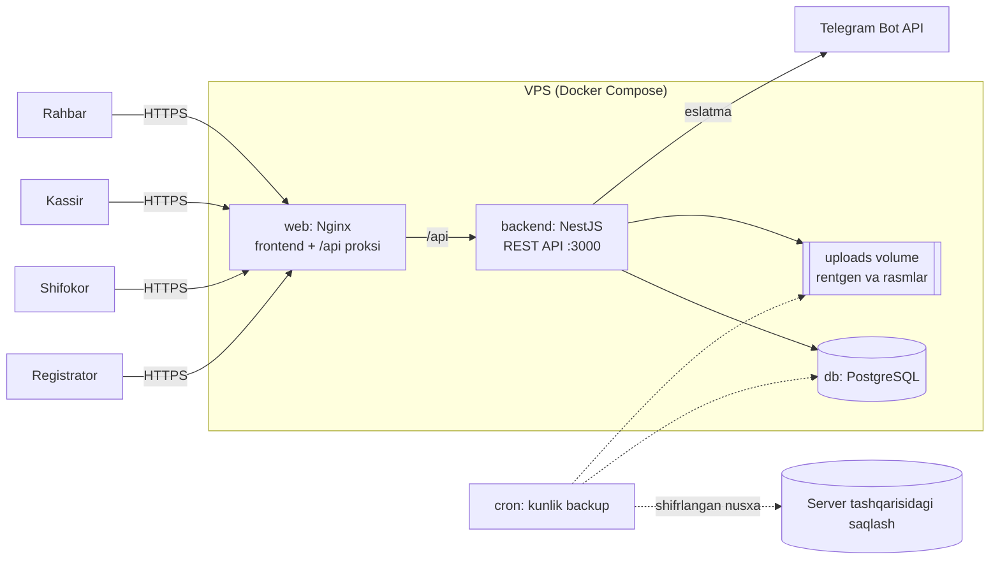
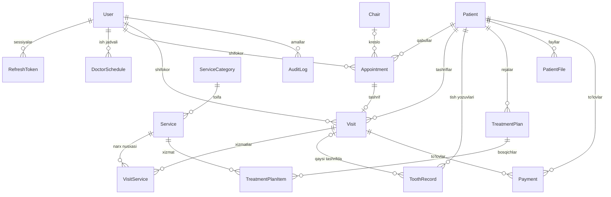
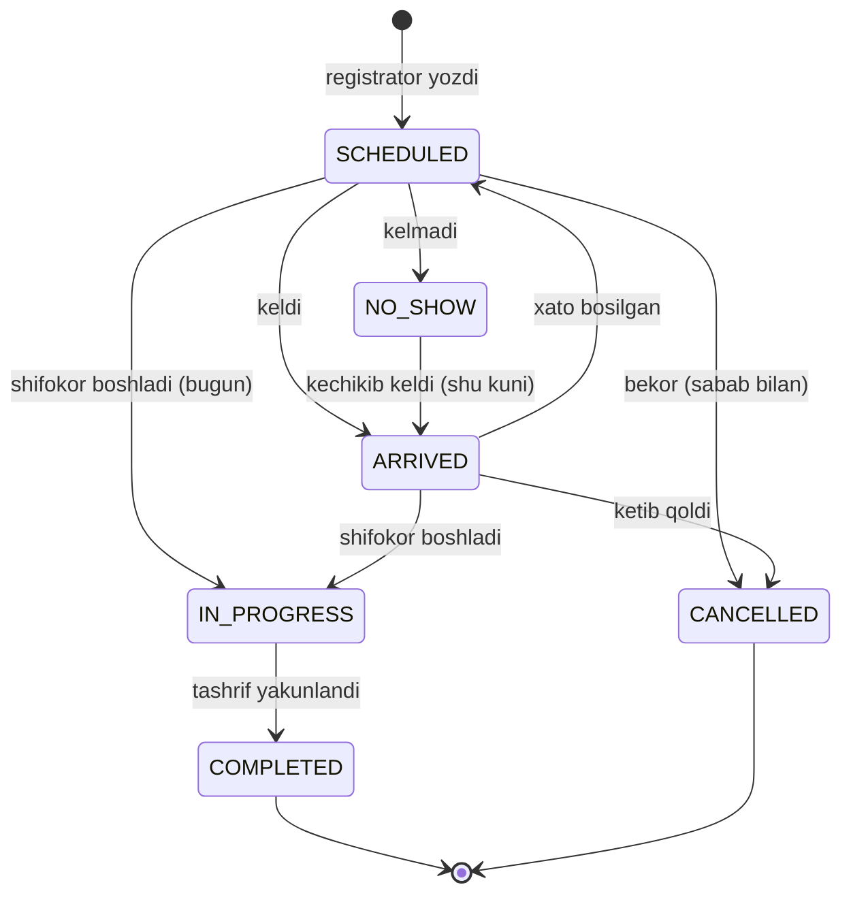
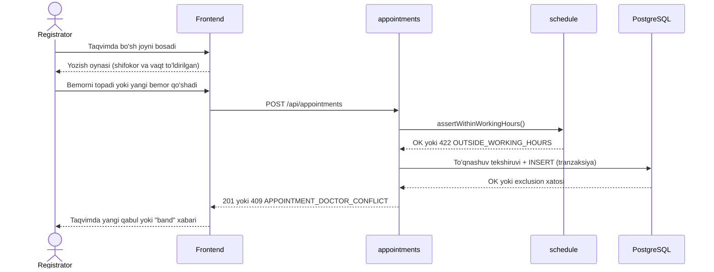
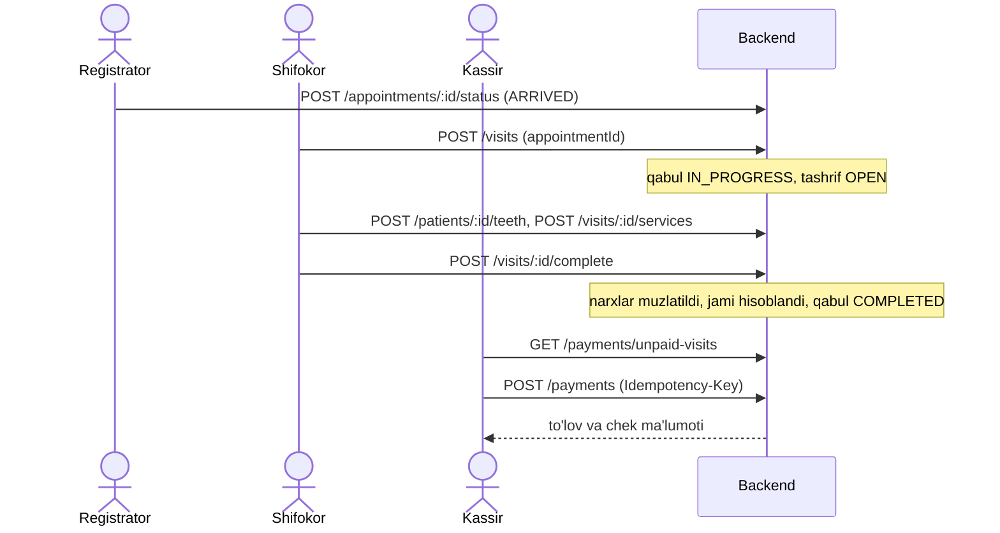

# F-2 arxitekturasi

> **Holat:** v1.0, qoralama (19-noyabr 2026). T-05 da Shoxjahon jamoaga tushuntiradi. T-01–T-03 (klinika intervyusi, MVP doirasi, rollar) natijasiga qarab yangilanadi.
> Bu hujjat faqat PR orqali o'zgartiriladi, PR'ni Shoxjahon va Ilyos ko'rib chiqadi.

**Kim o'qiydi:** hamma. Keyin o'z TZ'ingizni o'qing: [tz/README.md](tz/README.md). Endpoint'lar ro'yxati va javob shakllari: [api.md](api.md).

## Mundarija

1. [Bir qarashda](#1-bir-qarashda)
2. [Asosiy qarorlar](#2-asosiy-qarorlar)
3. [Tizim sxemasi](#3-tizim-sxemasi)
4. [Backend modullari va egalari](#4-backend-modullari-va-egalari)
5. [Frontend tuzilmasi va sahifalar](#5-frontend-tuzilmasi-va-sahifalar)
6. [Ma'lumotlar modeli](#6-malumotlar-modeli)
7. [Biznes qoidalar](#7-biznes-qoidalar)
8. [Asosiy oqimlar](#8-asosiy-oqimlar)
9. [Rollar va ruxsatlar](#9-rollar-va-ruxsatlar)
10. [Xavfsizlik](#10-xavfsizlik)
11. [Muhitlar, deploy va backup](#11-muhitlar-deploy-va-backup)
12. [Kod qoidalari](#12-kod-qoidalari)
13. [Ochiq savollar va qarorlar](#13-ochiq-savollar-va-qarorlar)

---

## 1. Bir qarashda

- **Modulli monolit.** Bitta NestJS backend (ichi modullarga bo'lingan), bitta React SPA, bitta PostgreSQL. Hammasi bitta serverda, Docker Compose bilan.
- Frontend va backend faqat **REST API** orqali gaplashadi. Kontrakt — Swagger (OpenAPI). Frontend tiplari Swagger'dan avtomatik generatsiya qilinadi.
- **Avval kontrakt.** Har backend task birinchi kuni endpoint shaklini (controller + DTO + Swagger, soxta javob bilan) alohida kichik PR qiladi. Frontend shu shakl bo'yicha darhol ishni boshlaydi.
- Har modulning **bitta egasi** bor (4-bo'lim). Boshqa birovning moduliga tegish kerak bo'lsa, egasi bilan kelishasiz va PR'ni o'sha odam ko'rib chiqadi.

## 2. Asosiy qarorlar

| # | Qaror | Nega | Nimadan voz kechdik |
| --- | --- | --- | --- |
| Q1 | Modulli monolit (NestJS modullari) | 7 kishi, 6 hafta: bitta deploy, bitta baza, debug oson | Mikroservislar — keraksiz murakkablik |
| Q2 | REST + OpenAPI, "avval kontrakt" | Frontend backendni kutib qolmaydi; tiplar avtomatik | GraphQL — jamoa uchun yangi, foydasi kam |
| Q3 | PostgreSQL + Prisma 7 | Bog'langan ma'lumot, tranzaksiya. Vaqt to'qnashuvini **bazaning o'zi** taqiqlaydi (exclusion constraint) | MongoDB — bog'lanish va tranzaksiyada zaif |
| Q4 | Access JWT (15 daqiqa, faqat xotirada) + refresh token (httpOnly cookie, 14 kun, bazada hash, har safar almashadi) | XSS bo'lsa ham refresh token o'g'irlanmaydi; xodim bloklansa darhol chiqib ketadi | Tokenni `localStorage`da saqlash — XSS'da o'g'irlanadi |
| Q5 | Pul — butun so'm, `Int` | `Float`da yaxlitlash xatolari bo'ladi; so'mda tiyin ishlatilmaydi | `Float`, `Decimal` |
| Q6 | Vaqt bazada UTC, ekranda Asia/Tashkent (UTC+5) | Bitta haqiqat manbai; hisobotda kun chegarasi aniq | Mahalliy vaqtni bazaga yozish |
| Q7 | Tish raqamlash — **FDI** (ISO 3950): doimiy tishlar 11–48, sut tishlari 51–85 | Xalqaro va MDH'da standart, shifokorlar shunga o'rgangan | 1–32 (Universal) tizimi |
| Q8 | Qabul taqvimi — **react-big-calendar** (MIT) | Shifokorlar ustun-ustun turadigan kun ko'rinishi bepul | FullCalendar: aynan shu ko'rinish (resource view) **pullik Premium** plagin |
| Q9 | UI — Ant Design 6 + o'z temasi | Jadval, forma, sana tanlash tayyor; tema tokenlari bilan o'ziga xos ko'rinish | Komponentlarni noldan yozish |
| Q10 | Fayllar server diskida (Docker volume), faqat API orqali, ruxsat tekshirilib beriladi | MVP uchun yetarli, tibbiy sir himoyalanadi | Ochiq statik papka |
| Q11 | Real vaqt yo'q: navbat va taqvim 30–60 soniyada o'zi yangilanadi (polling) | Oddiy va ishonchli | WebSocket — MVP uchun ortiqcha |
| Q12 | Interfeys tili — o'zbek (lotin) | Klinika xodimlari uchun | i18n kutubxonasi — T-01 da rus tili kerak bo'lsa, 25.11 gacha qayta ko'riladi |

Ataylab ishlatmaymiz: mikroservis, Kubernetes, Redis, GraphQL, SSR (Next.js), WebSocket.

## 3. Tizim sxemasi



So'rov yo'li: brauzer → `https://<domen>/api/...` → Nginx → backend → Prisma → PostgreSQL.
Lokalda Vite (`:5173`) `/api` so'rovlarini `localhost:3000` ga proksi qiladi, shuning uchun URL va cookie'lar production'dagidek ishlaydi.

## 4. Backend modullari va egalari

| Modul (papka) | Nima qiladi | Jadvallar (yozadi) | Egasi | Tasklar |
| --- | --- | --- | --- | --- |
| `config/`, `prisma/`, `common/`, `health/` | Skelet, env tekshiruvi, yagona xato formati, umumiy utilitlar | — | Muhammadyusuf | T-08, T-10 |
| `auth/` | Login, tokenlar, parol almashtirish, RBAC guard'lar, tibbiy ma'lumotga kirish tekshiruvi | RefreshToken | Shoxjahon | T-15, T-16 |
| `users/` | Xodimlar, shifokorlar ro'yxati | User | Muhammadyusuf | T-17 |
| `audit/` | `AuditService.log()`, amallar jurnali API | AuditLog | Muhammadyusuf | T-17, T-58 |
| `patients/` | Bemorlar, qidiruv | Patient | Muhammadyusuf | T-18 |
| `catalog/` | Xizmat toifalari va narxlar | ServiceCategory, Service | Muhammadyusuf | T-19 |
| `schedule/` | Kreslolar, shifokor ish jadvali | Chair, DoctorSchedule | Muhammadyusuf | T-30 |
| `appointments/` | Qabul, statuslar, vaqt to'qnashuvi | Appointment | Shoxjahon | T-28, T-29 |
| `visits/` | Tashrif, bajarilgan xizmatlar, chegirma | Visit, VisitService | Shoxjahon | T-38, T-47 |
| `dental-chart/` | Tish formulasi | ToothRecord | Shoxjahon | T-37 |
| `treatment-plans/` | Davolash rejasi | TreatmentPlan, TreatmentPlanItem | Muhammadyusuf | T-39 |
| `files/` | Rentgen, rasm, hujjatlar | PatientFile | Muhammadyusuf | T-40 |
| `payments/` | To'lov, qaytarish, balans, chek | Payment | Shoxjahon | T-47 |
| `reports/` | Tushum, shifokor ulushi, qarzdorlar, Excel | — (faqat o'qiydi) | Muhammadyusuf | T-48, T-49 |
| `notifications/` | Telegram eslatma | Patient.telegramChatId, Appointment.reminderSentAt | Shoxjahon | T-52 |

> README'dagi daraxtdan farqi: `services/` → `catalog/` (NestJS'da `ServicesService` degan chalkash nom chiqmasligi uchun). Ish jadvali va kreslolar alohida `schedule/` moduliga, tibbiy karta 4 ta modulga bo'lindi — har modulning bitta egasi bo'lishi uchun.

**Modullar o'rtasidagi qoidalar:**

1. Har modul **faqat o'z jadvallariga yozadi**. Boshqa modul ma'lumotini o'zgartirish kerak bo'lsa, o'sha modul service'ining metodini chaqiradi. Masalan, tashrif yakunlanganda `visits` qabul statusini `AppointmentsService.markCompleted(id, tx)` orqali o'zgartiradi, ikkalasi bitta tranzaksiyada.
2. **O'qish** uchun boshqa modul jadvaliga Prisma orqali so'rov yozish mumkin (masalan, `reports` hamma jadvalni o'qiydi).
3. Modullar orasidagi metodlar (4.1-jadval) **stub** sifatida oldinroq yoziladi: imzo tayyor, ichi vaqtincha oddiy. Shunda ikki dasturchi bir-birini kutmaydi.

### 4.1 Modullar orasidagi interfeyslar

| Metod | Kim yozadi | Kim ishlatadi | Stub muddati |
| --- | --- | --- | --- |
| `hashPassword(plain)`, `verifyPassword(plain, hash)` — `common/password.ts` | Muhammadyusuf (T-17) | users, auth | 26.11 |
| `AuthService.revokeAllSessions(userId)` | Shoxjahon (T-15) | users (bloklash, parolni tiklash) | 26.11 |
| `AuditService.log(entry, tx?)` | Muhammadyusuf (T-17) | hamma modullar | 27.11 |
| `CatalogService.getActiveService(id)` → `{ id, name, price, durationMin }` | Muhammadyusuf (T-19) | visits, treatment-plans | 02.12 |
| `MedicalAccessService.assertCanView(user, patientId)` | Shoxjahon (T-16) | visits, dental-chart, treatment-plans, files | 02.12 |
| `ScheduleService.assertWithinWorkingHours(doctorId, startAt, endAt)` | Muhammadyusuf (T-30) | appointments | 03.12 |
| `AppointmentsService.markInProgress(id, tx)`, `markCompleted(id, tx)` | Shoxjahon (T-28) | visits | 06.12 |
| `PaymentsService.getVisitBalance(visitId)`, `getPatientBalance(patientId)` | Shoxjahon (T-47) | reports | 18.12 |

### 4.2 Backend papkalari

```
backend/
├── prisma/
│   ├── schema.prisma
│   ├── migrations/
│   └── seed.ts
├── prisma.config.ts
├── test/                      # e2e testlar (supertest)
└── src/
    ├── main.ts                # prefiks /api, ValidationPipe, Swagger /api/docs, helmet
    ├── app.module.ts
    ├── config/                # env tekshiruvi (zod)
    ├── prisma/                # PrismaService (global modul)
    ├── common/
    │   ├── decorators/        # @Public, @Roles, @CurrentUser (Shoxjahon, T-16)
    │   ├── guards/            # JwtAuthGuard, RolesGuard (Shoxjahon, T-16)
    │   ├── filters/           # yagona xato formati; Prisma xatolari → 404/409
    │   ├── dto/               # PaginationQueryDto, Paginated<T>
    │   ├── errors.ts          # ErrorCode ro'yxati (api.md, 2-bo'lim)
    │   ├── password.ts        # bcrypt
    │   ├── phone.ts           # +998 normallashtirish
    │   └── time.ts            # Toshkent kuni chegaralari, hafta kuni, daqiqalar
    ├── auth/  users/  audit/  patients/  catalog/  schedule/
    ├── appointments/  visits/  dental-chart/  treatment-plans/  files/
    ├── payments/  reports/  notifications/
    └── health/
```

Har modul ichida: `x.module.ts`, `x.controller.ts`, `x.service.ts`, `dto/`, `x.service.spec.ts`.

- **Controller** yupqa: DTO bilan tekshiradi, rolni belgilaydi, service'ni chaqiradi. Biznes logika controller'da bo'lmaydi.
- **Prisma faqat service ichida** ishlatiladi.
- Bir nechta jadvalga yoziladigan amal (tashrifni yakunlash, to'lov) — **bitta tranzaksiyada** (`prisma.$transaction`).

## 5. Frontend tuzilmasi va sahifalar

```
frontend/src/
├── main.tsx
├── app/
│   ├── router.tsx         # barcha yo'llar, lazy sahifalar, rol himoyasi
│   ├── providers.tsx      # QueryClient, AntD ConfigProvider (tema, uz_UZ), AuthProvider
│   ├── menu.ts            # menyu va ruxsatlar uchun yagona ro'yxat
│   └── theme.ts           # Sanjarning UI kit tokenlari
├── api/
│   ├── client.ts          # axios: baseURL "/api", token qo'shadi, 401 → refresh → qayta urinadi
│   ├── schema.d.ts        # openapi-typescript generatsiya qiladi (qo'lda tahrirlanmaydi)
│   └── <modul>.ts         # har modul uchun so'rovlar va React Query hook'lari
├── auth/                  # AuthProvider, useAuth, RequireAuth, RequireRole
├── layouts/               # MainLayout (menyu, header), AuthLayout
├── components/            # umumiy: PageHeader, PhoneInput, MoneyText, MoneyInput, StatusTag,
│                          # PatientSelect, EmptyState, ErrorState, ConfirmButton
├── features/
│   └── tooth-chart/       # ToothChart: tashrif sahifasida ham, bemor kartasida ham ishlatiladi
├── pages/                 # modul bo'yicha sahifalar
└── lib/                   # format.ts (pul, telefon, sana), dayjs.ts (Toshkent), labels.ts (status nomlari va ranglari)
```

**Qoidalar:**

- Serverdan keladigan ma'lumot — faqat TanStack Query (`useQuery`, `useMutation`). `useEffect` ichida `fetch` yozilmaydi. Redux, Zustand yo'q; global holat faqat `AuthContext`.
- Query kalitlari: `['patients', { search, page }]`, `['appointments', { from, to, doctorId }]`. Mutatsiyadan keyin tegishli kalitlar `invalidateQueries` qilinadi.
- Formalar — AntD Form, xato matnlari o'zbekcha.
- Har sahifada 4 holat bo'ladi: yuklanmoqda (Skeleton), bo'sh (EmptyState), xato (ErrorState + "Qayta urinish"), ma'lumot.
- Sana, pul va telefon faqat `lib/format.ts` orqali ko'rsatiladi. Status nomlari va ranglari faqat `lib/labels.ts` da turadi.

### 5.1 Sahifalar

| Yo'l | Sahifa | Kimga ochiq | Egasi | Task |
| --- | --- | --- | --- | --- |
| `/login` | Kirish | hamma (kirmagan) | Jahongir | T-20 |
| `/change-password` | Parolni almashtirish | hamma | Jahongir | T-20 |
| `/` | Rolga qarab yo'naltirish | hamma | Jahongir | T-21 |
| `/dashboard` | Bosh sahifa (rahbar) | ADMIN | Nurmuhammad | T-51 |
| `/calendar` | Qabul taqvimi | ADMIN, RECEPTIONIST, DOCTOR | Jahongir | T-31 |
| `/queue` | Bugungi navbat | ADMIN, RECEPTIONIST | Nurmuhammad | T-33 |
| `/patients` | Bemorlar | hamma | Nurmuhammad | T-22 |
| `/patients/:id` | Bemor kartasi (tablar rolga qarab) | hamma | Nurmuhammad | T-42 |
| `/doctor` | Shifokor ish stoli | DOCTOR | Jahongir | T-43 |
| `/visits/:id` | Tashrif | DOCTOR (ADMIN faqat ko'radi) | Jahongir | T-43, T-41 |
| `/cashier` | Kassa | CASHIER, ADMIN | Jahongir | T-50 |
| `/reports` | Hisobotlar | ADMIN (CASHIER: faqat qarzdorlar) | Nurmuhammad | T-51 |
| `/staff` | Xodimlar va ish jadvali | ADMIN | Jahongir | T-24 |
| `/settings/chairs` | Kreslolar | ADMIN | Jahongir | T-24 |
| `/catalog` | Xizmatlar va narxlar (tahrir: ADMIN) | hamma | Nurmuhammad | T-23 |
| `/dev/components` | Komponentlar vitrini (faqat lokal) | — | Nurmuhammad | T-13 |
| `*` | 404 va 403 sahifalari | — | Jahongir | T-21 |

Kirgandan keyin yo'naltirish: ADMIN → `/dashboard`, DOCTOR → `/doctor`, RECEPTIONIST → `/calendar`, CASHIER → `/cashier`. Bir nechta roli bo'lsa, shu tartibdagi birinchisi olinadi.

## 6. Ma'lumotlar modeli

16 ta jadval. To'liq Prisma sxemasini Shoxjahon T-06 da shu bo'lim asosida yozadi.



**Umumiy qoidalar:**

- Hamma `id` — `Int`, autoincrement.
- Vaqt maydonlari `DateTime` (UTC). Faqat sana kerak bo'lsa (`birthDate`) — `@db.Date`.
- Pul — `Int` (so'm). Foiz — `Int` (0–100).
- Hech narsa jismoniy o'chirilmaydi: bemor arxivlanadi, xodim bloklanadi, xizmat nofaol qilinadi, to'lov `REFUND` bilan qaytariladi, fayl `deletedAt` oladi.
- `createdAt` (`@default(now())`) va `updatedAt` (`@updatedAt`) — o'zgaradigan jadvallarda.

### 6.1 Enum'lar

| Enum | Qiymatlar |
| --- | --- |
| `Role` | `ADMIN`, `RECEPTIONIST`, `DOCTOR`, `CASHIER` |
| `Gender` | `MALE`, `FEMALE` |
| `AppointmentStatus` | `SCHEDULED` (yozilgan), `ARRIVED` (keldi, kutmoqda), `IN_PROGRESS` (qabulda), `COMPLETED` (yakunlandi), `CANCELLED` (bekor qilindi), `NO_SHOW` (kelmadi) |
| `VisitStatus` | `OPEN`, `COMPLETED` |
| `ToothStatus` | `HEALTHY` (sog'lom), `CARIES` (karies, C), `FILLED` (plomba, Pl), `PULPITIS` (pulpit, P), `PERIODONTITIS` (periodontit, Pt), `ROOT_ONLY` (ildiz qolgan, R), `CROWN` (toj, K), `IMPLANT` (implant, I), `MISSING` (yo'q, 0) — ro'yxatni T-01 da shifokor tasdiqlaydi |
| `PlanStatus` | `ACTIVE`, `COMPLETED`, `CANCELLED` |
| `PlanItemStatus` | `PLANNED`, `DONE`, `CANCELLED` |
| `FileKind` | `XRAY`, `PHOTO`, `DOCUMENT` |
| `PaymentType` | `PAYMENT`, `REFUND` |
| `PaymentMethod` | `CASH` (naqd), `CARD` (karta/terminal), `TRANSFER` (o'tkazma, Click/Payme) |

### 6.2 Jadvallar

`?` — maydon bo'sh bo'lishi mumkin.

**User** — xodim

| Maydon | Tip | Izoh |
| --- | --- | --- |
| fullName | String | "Aliyev Jasur" |
| username | String, unique | Login, kichik harflarda saqlanadi |
| passwordHash | String | bcrypt. API javobida hech qachon qaytmaydi |
| phone | String? | `+998901234567` |
| roles | Role[] | Kamida bitta. Bir xodimda bir nechta rol bo'lishi mumkin |
| isActive | Boolean = true | `false` — bloklangan |
| mustChangePassword | Boolean = true | Birinchi kirishda parolni almashtirish shart |
| specialty | String? | Shifokor uchun: "Terapevt" |
| color | String? | Shifokor uchun taqvim rangi, `#2F855A` |
| sharePercent | Int? | Shifokor ulushi, 0–100 |

**RefreshToken** — `userId`, `tokenHash` (String, unique, SHA-256), `expiresAt`, `revokedAt?`, `replacedById?`, `userAgent?`, `ip?`, `createdAt`.

**Chair** — `name` (String, unique), `isActive` (Boolean = true).

**DoctorSchedule** — haftalik ish vaqti

| Maydon | Tip | Izoh |
| --- | --- | --- |
| doctorId | Int → User | |
| weekday | Int | 1 = dushanba … 7 = yakshanba |
| startMinute | Int | Toshkent vaqti, kun boshidan daqiqa: 09:00 → 540 |
| endMinute | Int | 18:00 → 1080 |
| | unique(doctorId, weekday) | Kuniga bitta oraliq. Qatori yo'q kun — dam olish |

**Patient** — bemor

| Maydon | Tip | Izoh |
| --- | --- | --- |
| firstName, lastName | String | |
| middleName | String? | Otasining ismi |
| birthDate | DateTime? `@db.Date` | |
| gender | Gender? | |
| phone | String, index | `+998901234567`. Unique **emas**: ona va bolalar bitta raqamda bo'lishi mumkin (7.6) |
| phone2 | String? | |
| address | String? | |
| allergies | String? | Allergiya va muhim kasalliklar — kartada qizil bilan ko'rinadi |
| note | String? | |
| telegramChatId | String? | Eslatma uchun. Unique emas (oila bitta Telegram'da) |
| isArchived | Boolean = false | |
| createdById | Int? → User | |
| | index(lastName, firstName) | |

**ServiceCategory** — `name` (unique), `sortOrder` (Int = 0), `isActive`.

**Service** — xizmat

| Maydon | Tip | Izoh |
| --- | --- | --- |
| categoryId | Int → ServiceCategory | |
| code | String?, unique | Ichki kod, ixtiyoriy |
| name | String | unique(categoryId, name) |
| price | Int | So'm, ≥ 0 |
| durationMin | Int = 30 | Qabul uchun taxminiy vaqt |
| isActive | Boolean = true | O'chirilmaydi, nofaol qilinadi |

**Appointment** — qabul

| Maydon | Tip | Izoh |
| --- | --- | --- |
| patientId | Int → Patient | |
| doctorId | Int → User | |
| chairId | Int? → Chair | |
| startAt, endAt | DateTime | `endAt > startAt` |
| status | AppointmentStatus = SCHEDULED | |
| note | String? | |
| cancelReason | String? | Bekor qilinganda majburiy |
| arrivedAt | DateTime? | "Keldi" bosilgan vaqt — kutish vaqtini ko'rsatish uchun |
| reminderSentAt | DateTime? | Eslatma yuborilgan vaqt |
| createdById | Int → User | |
| | index(doctorId, startAt), index(chairId, startAt), index(patientId) | |

**Visit** — tashrif

| Maydon | Tip | Izoh |
| --- | --- | --- |
| appointmentId | Int, unique → Appointment | Bitta qabul — bitta tashrif |
| patientId, doctorId | Int | |
| status | VisitStatus = OPEN | |
| complaint, diagnosis, note | String? | Shikoyat, tashxis, izoh. Yakunlashda tashxis majburiy |
| startedAt | DateTime = now | |
| completedAt | DateTime? | |
| subtotal | Int = 0 | Xizmatlar yig'indisi (yakunlanganda hisoblanadi) |
| discountAmount | Int = 0 | |
| discountReason | String? | |
| total | Int = 0 | `subtotal − discountAmount` |
| doctorSharePercent | Int? | Yakunlangan paytdagi shifokor foizi (nusxa) |
| | index(patientId), index(doctorId, completedAt) | |

**VisitService** — tashrifda bajarilgan xizmat: `visitId`, `serviceId`, `serviceName` (nusxa), `toothNumber?`, `quantity` (Int = 1), `unitPrice` (nusxa), `amount` (`unitPrice × quantity`).

**ToothRecord** — tish holati yozuvi (tarix): `patientId`, `toothNumber` (Int, FDI), `status` (ToothStatus), `note?`, `visitId?`, `doctorId`, `createdAt`. Index: `(patientId, toothNumber, createdAt)`.

**TreatmentPlan** — `patientId`, `doctorId`, `title`, `status` (PlanStatus = ACTIVE), `note?`.

**TreatmentPlanItem** — `planId`, `serviceId`, `serviceName` (nusxa), `toothNumber?`, `stage` (Int = 1), `quantity` (Int = 1), `unitPrice` (nusxa), `status` (PlanItemStatus = PLANNED), `visitId?` (qaysi tashrifda bajarildi), `note?`.

**PatientFile** — `patientId`, `visitId?`, `kind` (FileKind), `originalName`, `mimeType`, `sizeBytes`, `storageKey` (unique; serverdagi fayl yo'li, foydalanuvchi kiritmaydi), `note?`, `uploadedById`, `createdAt`, `deletedAt?`.

**Payment** — to'lov yoki qaytarish

| Maydon | Tip | Izoh |
| --- | --- | --- |
| visitId | Int → Visit | Har to'lov aniq tashrif uchun |
| patientId | Int → Patient | Qidiruv va hisobot uchun takrorlangan |
| type | PaymentType | `PAYMENT` yoki `REFUND` |
| method | PaymentMethod | |
| amount | Int | Doim musbat (> 0) |
| refundOfId | Int? → Payment | `REFUND` qaysi to'lovni qaytaradi |
| note, reason | String? | Qaytarishda `reason` majburiy |
| cashierId | Int → User | |
| clientRequestId | String?, unique | Ikki marta bosilganda dublikat bo'lmasligi uchun (7.3) |
| | index(visitId), index(patientId), index(createdAt) | |

**AuditLog** — `actorId?`, `action` (String: `CREATE`, `UPDATE`, `ARCHIVE`, `STATUS_CHANGE`, `LOGIN`, `LOGIN_FAILED`, `FILE_VIEW`, `REFUND` …), `entity` (String: `Patient`, `Visit` …), `entityId?`, `summary?`, `before?` (Json), `after?` (Json), `ip?`, `createdAt`. Index: `(entity, entityId)`, `(createdAt)`. Parol, token va hash hech qachon yozilmaydi.

### 6.3 Bazadagi qo'shimcha cheklovlar

Prisma bularni o'zi yaratmaydi. `prisma migrate dev --create-only` bilan migratsiya ochib, SQL'ni qo'lda qo'shasiz:

```sql
CREATE EXTENSION IF NOT EXISTS btree_gist;

-- Bitta shifokorga bir vaqtda ikki faol qabul bo'lmaydi
ALTER TABLE "Appointment" ADD CONSTRAINT "appointment_doctor_no_overlap"
  EXCLUDE USING gist ("doctorId" WITH =, tsrange("startAt", "endAt", '[)') WITH &&)
  WHERE (status NOT IN ('CANCELLED', 'NO_SHOW'));

-- Bitta kresloda ham
ALTER TABLE "Appointment" ADD CONSTRAINT "appointment_chair_no_overlap"
  EXCLUDE USING gist ("chairId" WITH =, tsrange("startAt", "endAt", '[)') WITH &&)
  WHERE ("chairId" IS NOT NULL AND status NOT IN ('CANCELLED', 'NO_SHOW'));

ALTER TABLE "Appointment" ADD CONSTRAINT "appointment_time_valid" CHECK ("endAt" > "startAt");
ALTER TABLE "Payment" ADD CONSTRAINT "payment_amount_positive" CHECK ("amount" > 0);
ALTER TABLE "Service" ADD CONSTRAINT "service_price_non_negative" CHECK ("price" >= 0);
ALTER TABLE "User" ADD CONSTRAINT "user_share_percent_range" CHECK ("sharePercent" BETWEEN 0 AND 100);
ALTER TABLE "DoctorSchedule" ADD CONSTRAINT "schedule_time_valid" CHECK ("startMinute" < "endMinute");
```

`[)` — oraliq oxiri kirmaydi: 10:00–10:30 va 10:30–11:00 to'qnashmaydi. Prisma `DateTime`ni standart holatda `timestamp(3)` (zonasiz) qiladi, shuning uchun `tsrange`. Agar maydonlarga `@db.Timestamptz` qo'yilsa, `tstzrange` ishlatiladi.

Prisma bu cheklovlarni bilmaydi. Shuning uchun har yangi migratsiya SQL'ini commit'dan oldin o'qing: unda shu cheklovlar yoki ularning indekslari uchun `DROP CONSTRAINT` / `DROP INDEX` paydo bo'lsa, o'sha qatorlarni olib tashlang va Shoxjahonga ayting.

## 7. Biznes qoidalar

### 7.1 Qabul



| O'tish | Kim | Shart |
| --- | --- | --- |
| SCHEDULED → ARRIVED | RECEPTIONIST, ADMIN | Qabul kuni bugun. `arrivedAt` yoziladi |
| SCHEDULED → CANCELLED | RECEPTIONIST, ADMIN | `reason` majburiy |
| SCHEDULED → NO_SHOW | RECEPTIONIST, ADMIN | `startAt` o'tgan bo'lsa |
| NO_SHOW → ARRIVED | RECEPTIONIST, ADMIN | Shu kuni |
| ARRIVED → SCHEDULED | RECEPTIONIST, ADMIN | Xato bosilganini qaytarish |
| ARRIVED → CANCELLED | RECEPTIONIST, ADMIN | `reason` majburiy |
| ARRIVED / bugungi SCHEDULED → IN_PROGRESS | Faqat `POST /api/visits` orqali | O'sha qabulning shifokori |
| IN_PROGRESS → COMPLETED | Faqat `POST /api/visits/:id/complete` orqali | O'sha shifokor |

Boshqa har qanday o'tish — `422 INVALID_STATUS_TRANSITION`.

**Vaqt qoidalari:**

- Davomiylik 10–240 daqiqa, 5 ga karrali.
- O'tgan kunga yozib bo'lmaydi. Bugungi kunga — mumkin (navbatsiz kelgan bemor). 90 kundan uzoqqa yozib bo'lmaydi.
- Qabul shifokorning shu kungi ish oralig'i ichida bo'lishi kerak, aks holda `422 OUTSIDE_WORKING_HOURS`.
- **To'qnashuv:** ikki qabul `a.startAt < b.endAt` va `b.startAt < a.endAt` bo'lsa ustma-ust tushadi. Faol statuslar (`SCHEDULED`, `ARRIVED`, `IN_PROGRESS`, `COMPLETED`) to'qnashadi; `CANCELLED` va `NO_SHOW` joyni bo'shatadi. Tekshiruv ikki qatlamda:
  1. Service'da oldindan so'rov — chiroyli xabar uchun: `409 APPOINTMENT_DOCTOR_CONFLICT` yoki `APPOINTMENT_CHAIR_CONFLICT`, `details`da band qilgan qabul.
  2. Bazadagi exclusion constraint (6.3) — ikki registrator bir soniyada yozsa ham ikkinchisi o'tmaydi.
- Ko'chirish (`PATCH`) faqat `SCHEDULED` va `ARRIVED` uchun; tekshiruvlar qaytadan bajariladi. Sana o'zgarsa, `reminderSentAt` tozalanadi.

### 7.2 Tashrif

- Bitta qabulga bitta tashrif. Tashrifni faqat o'sha qabulning shifokori boshlaydi va yuritadi.
- `OPEN` holatda: shikoyat, tashxis, izoh, xizmatlar qo'shiladi yoki olib tashlanadi, tish holati yoziladi.
- Xizmat qo'shilganda nomi va narxi katalogdan **nusxalanadi** (`serviceName`, `unitPrice`). Keyin preyskurant o'zgarsa ham tashrif summasi o'zgarmaydi.
- **Yakunlash** (bitta tranzaksiya): tashxis bo'sh bo'lmasligi kerak → `subtotal` va `total` hisoblanadi → shifokor foizi `doctorSharePercent`ga nusxalanadi → `status = COMPLETED`, `completedAt` → qabul `COMPLETED`. Shundan keyin tashrif kassada qarz sifatida ko'rinadi.
- Yakunlangan tashrif o'zgarmaydi. Xato bo'lsa — chegirma yoki qaytarish orqali to'g'rilanadi.

### 7.3 Pul

```
tashrif.total      = subtotal − discountAmount
tashrif.tolangan   = Σ PAYMENT.amount − Σ REFUND.amount   (shu tashrif bo'yicha)
tashrif.qarz       = total − tolangan
bemor.qarz         = Σ tashrif.qarz   (faqat COMPLETED tashriflar)
```

- Qarz bazada **saqlanmaydi**, har safar hisoblanadi (bitta SQL so'rov bilan, N+1 emas).
- To'lov faqat `COMPLETED` tashrifga; `0 < amount ≤ qarz`, aks holda `422 PAYMENT_EXCEEDS_DEBT`. Avans (oldindan to'lov) MVP'da yo'q.
- **Ikki marta bosish himoyasi:** frontend har to'lov oynasi uchun UUID yaratib, `Idempotency-Key` sarlavhasida yuboradi. Backend uni `clientRequestId`ga yozadi; xuddi shu kalit qayta kelsa, yangi to'lov yaratmay, avvalgisini qaytaradi.
- **Ikki kassir bir vaqtda:** to'lov tranzaksiyasi tashrif qatorini `SELECT … FOR UPDATE` bilan qulflaydi, keyin qarzni hisoblab, yozadi.
- **Chegirma:** CASHIER (subtotal'ning 10% igacha, `CASHIER_MAX_DISCOUNT_PERCENT`) va ADMIN (cheksiz). Faqat tashrifga hali to'lov qilinmagan bo'lsa; `reason` majburiy; `amount ≤ subtotal`.
- **Qaytarish (REFUND):** faqat ADMIN. Asl to'lovga bog'lanadi; jami qaytarilgan summa asl to'lovdan oshmaydi; `reason` majburiy; usul asl to'lovniki bilan bir xil.
- Har pul amali `AuditLog`ga yoziladi.

### 7.4 Shifokor ulushi

- Tashrif yakunlanganda `doctorSharePercent = User.sharePercent ?? 0` nusxalanadi.
- Davr bo'yicha hisobotda ikkala ko'rsatkich chiqadi; qaysi biri rasmiy ekanini T-01 da klinika aytadi:
  - **hisoblangan:** davrda yakunlangan tashriflar `total × foiz / 100`;
  - **to'langan:** davrda tushgan sof to'lovlar (`PAYMENT − REFUND`) `× tashrif foizi / 100`.
- Yaxlitlash: har tashrif yoki to'lov bo'yicha pastga (`Math.floor`), keyin yig'iladi.

### 7.5 Tish formulasi

- Ruxsat etilgan raqamlar: doimiy 11–18, 21–28, 31–38, 41–48; sut tishlari 51–55, 61–65, 71–75, 81–85. Boshqasi — `400 VALIDATION_ERROR`.
- Har o'zgarish yangi `ToothRecord` qatori. Tishning hozirgi holati — o'sha tish bo'yicha eng oxirgi yozuv. Yozuvi yo'q tish — `HEALTHY`.
- Yozishni faqat shifokor, o'zining shu bemordagi `OPEN` tashrifi doirasida qiladi (`visitId` majburiy).

### 7.6 Bemor

- Telefon `+998XXXXXXXXX` ko'rinishiga keltiriladi: `90 123 45 67`, `998901234567`, `+998 (90) 123-45-67` — hammasi `+998901234567`. 9 raqam (kodsiz) kiritilsa, `+998` qo'shiladi; boshqa uzunlik — xato.
- **Dublikat:** bir xil telefon **va** bir xil familiya + ism (katta-kichik harf farqsiz) — `409 PATIENT_DUPLICATE`. Bir xil telefon, lekin boshqa ism (ona va bolasi) — ruxsat. Formada `GET /api/patients/check-phone` orqali "bu raqamda N ta bemor bor" ogohlantirishi chiqadi.
- Qidiruv: so'zda kamida 3 ta raqam bo'lsa — telefon bo'yicha; aks holda har so'z familiya, ism yoki otasining ismidan birida uchrashi kerak (katta-kichik harf farqsiz).
- Arxivlangan bemor qidiruvda chiqmaydi (ADMIN `archived=true` bilan ko'radi).

### 7.7 Vaqt

- Server jarayoni UTC'da ishlaydi. Klinika vaqt zonasi — `CLINIC_TIMEZONE=Asia/Tashkent` (UTC+5, yozgi vaqt yo'q).
- "Kun" har doim Toshkent kuni: `2026-12-17` → `2026-12-16T19:00:00Z` dan `2026-12-17T19:00:00Z` gacha. Bu hisob faqat `common/time.ts` dagi funksiyalarda (bitta joyda), testlari bilan.
- Klinika kompyuterlari Toshkent vaqt zonasida bo'lishi shart. Brauzer zonasi boshqa bo'lsa, frontend ogohlantirish chiqaradi.

## 8. Asosiy oqimlar

### 8.1 Qabulga yozish



### 8.2 Tashrif va to'lov



## 9. Rollar va ruxsatlar

> Qoralama. Yakuniy jadvalni Ilyos T-03 da tasdiqlaydi; o'zgarsa, shu jadval va `api.md` birga yangilanadi.

| Amal | ADMIN | RECEPTIONIST | DOCTOR | CASHIER |
| --- | :---: | :---: | :---: | :---: |
| Xodimlar, rollar, parolni tiklash | ✅ | — | — | — |
| Xizmat va narxlarni o'zgartirish | ✅ | — | — | — |
| Xizmatlar ro'yxatini ko'rish | ✅ | ✅ | ✅ | ✅ |
| Kreslo va ish jadvalini o'zgartirish | ✅ | — | — | — |
| Bemor qo'shish va tahrirlash | ✅ | ✅ | faqat `allergies` | — |
| Bemorni qidirish, asosiy ma'lumot | ✅ | ✅ | ✅ | ✅ |
| Bemorni arxivlash | ✅ | — | — | — |
| Qabulga yozish, ko'chirish, bekor qilish | ✅ | ✅ | — | — |
| Taqvimni ko'rish | ✅ hammasi | ✅ hammasi | o'z qabullari | — |
| "Keldi" / "Kelmadi" | ✅ | ✅ | — | — |
| Tashrifni boshlash, yuritish, yakunlash | DOCTOR roli bo'lsa | — | o'z qabullari | — |
| Tibbiy karta: tish formulasi, tashriflar, reja, fayllar | ✅ | — | o'z bemorlari* | — |
| To'lov qabul qilish | ✅ | — | — | ✅ |
| Chegirma | ✅ | — | — | ✅ (≤ 10%) |
| Qaytarish (refund) | ✅ | — | — | — |
| Bemor balansi va qarzi | ✅ | ✅ ko'radi | — | ✅ |
| Hisobotlar | ✅ | — | — | faqat qarzdorlar |
| Amallar jurnali | ✅ | — | — | — |

\* **O'z bemori** — shu shifokor bilan kamida bitta qabul yoki tashrifi bor bemor (`MedicalAccessService`).

**Qanday ishlaydi:**

1. `JwtAuthGuard` (global): tokenni tekshiradi va foydalanuvchini **har so'rovda bazadan o'qiydi** (`isActive`, `roles`), shuning uchun bloklash va rol o'zgarishi darhol kuchga kiradi. `@Public()` bilan belgilangan endpoint'lar bundan mustasno.
2. `RolesGuard` + `@Roles(...)`: kerakli rollardan kamida bittasi bo'lishi kerak.
3. Qatordagi ruxsat (masalan, "o'z bemori", "o'z qabuli") — service ichida tekshiriladi.
4. `mustChangePassword = true` bo'lsa, faqat `/auth/me`, `/auth/change-password`, `/auth/logout` ishlaydi; qolgani `403 PASSWORD_CHANGE_REQUIRED`.

## 10. Xavfsizlik

**Kirish va sessiya**

- Parol: bcrypt (cost 12), kamida 8 belgi, login bilan bir xil bo'lmaydi.
- Login xatosi doim bir xil: "Login yoki parol noto'g'ri" — qaysi biri xatoligini aytmaymiz.
- Login'ga limit: bir IP'dan daqiqasiga 5 urinish (`@nestjs/throttler`) → `429`. Nginx ortida real IP uchun `trust proxy` yoqiladi.
- Access token 15 daqiqa, faqat xotirada. Refresh token: 32 bayt tasodifiy, bazada SHA-256 hash, cookie `rt`: `HttpOnly; Secure; SameSite=Strict; Path=/api/auth`.
- Refresh har safar almashadi. Bekor qilingan refresh token qayta kelsa (o'g'irlanish belgisi), foydalanuvchining hamma sessiyalari yopiladi.
- Xodim bloklansa yoki paroli tiklansa — hamma refresh tokenlari bekor qilinadi.

**API**

- `ValidationPipe({ whitelist: true, forbidNonWhitelisted: true, transform: true })` — DTO'da yo'q maydon rad etiladi.
- SQL faqat Prisma orqali. Xom so'rov kerak bo'lsa — faqat `$queryRaw` (template), hech qachon `$queryRawUnsafe` + foydalanuvchi matni.
- ID bo'yicha har endpoint rol **va** egalikni tekshiradi (boshqa shifokorning bemorini `id`ni almashtirib ochib bo'lmaydi).
- 500 xatoda stack trace qaytmaydi; batafsil faqat server logida.
- `helmet()` yoqiladi. Production'da CORS o'chiq (frontend bilan bitta domen). Production'da Swagger o'chiq.

**Ma'lumot**

- Bemor ma'lumoti — tibbiy sir. Lokal va staging'da faqat soxta ma'lumot (seed). Production ma'lumoti noutbuklarga, chatlarga, skrinshotlarga ko'chirilmaydi.
- Logga parol, token, tashxis va izoh matnlari yozilmaydi.
- Bemor, tashrif, tish holati, fayl, to'lov va xodim o'zgarishlari `AuditLog`ga yoziladi (kim, qachon, nima, oldin/keyin).

**Fayllar**

- Ruxsat etilgan turlar: JPEG, PNG, WEBP, PDF. Tur fayl **ichidagi birinchi baytlardan** tekshiriladi (faqat brauzer yuborgan `mimetype`ga ishonilmaydi). SVG va HTML qabul qilinmaydi.
- Hajm ≤ 15 MB. Diskdagi nom — tasodifiy UUID, foydalanuvchi kiritgan nom faqat bazada.
- Fayl faqat `GET /api/files/:id/content` orqali, ruxsat tekshirilib beriladi: `X-Content-Type-Options: nosniff`, `Cache-Control: private, no-store`.

**Frontend**

- `dangerouslySetInnerHTML` ishlatilmaydi. Token `localStorage`da saqlanmaydi.

**Infratuzilma**

- `.env` va parollar repoda yo'q, faqat `.env.example`. Har muhitning siri alohida (staging siri production'da ishlatilmaydi).
- Serverda SSH faqat kalit bilan, root bilan kirish o'chiq, firewall faqat 22/80/443.
- **Qonun:** "Shaxsga doir ma'lumotlar to'g'risida"gi qonun (27¹-modda) O'zbekiston fuqarolarining shaxsiy ma'lumotlarini O'zbekiston hududidagi serverlarda saqlashni talab qiladi. Production serveri va uning backup nusxasi — O'zbekistonda. Staging (soxta ma'lumot) istalgan joyda bo'lishi mumkin.

### 10.1 Ochiq (public) repo qoidalari

Repo public: kod, commit tarixi, issue, PR va Actions loglarini **hamma** ko'radi. Bir marta push qilingan narsa o'chirilgandan keyin ham boshqalarda yoki keshda qolishi mumkin.

- Repoga hech qachon tushmaydi: `.env`, parol, token, kalit, server kirish ma'lumotlari, haqiqiy bemor ma'lumoti, klinikaning ichki fayllari, haqiqiy ma'lumot ko'ringan skrinshot.
- Sir tasodifan push qilinsa — darhol Diyorbek va Ilyosga ayting va **sirni almashtiring** (yangi parol yoki token). Commit'ni o'chirish yetarli emas.
- GitHub'da Secret scanning va Push protection yoqiladi (public repoda bepul): sir bor push'ni GitHub o'zi to'xtatadi.
- Actions: sirlar faqat GitHub Secrets'da, loglarga chiqarilmaydi. `pull_request_target` ishlatilmaydi. Tashqi odamlarning (fork'dan) workflow'lari faqat tasdiq bilan ishga tushadi.
- Har kim git'da GitHub'ning **noreply** email'ini ishlatadi — shaxsiy email commit tarixida ochilib qolmasin.
- Xavfsizlik "kodni hech kim ko'rmaydi" degan farazga tayanmaydi: kod ochiq bo'lsa ham tizim xavfsiz bo'lishi kerak.

## 11. Muhitlar, deploy va backup

| Muhit | Qayerda | Ma'lumot | Deploy | Manzil |
| --- | --- | --- | --- | --- |
| local | Dasturchi kompyuteri | Seed (soxta) | `npm run dev` | `localhost:5173` |
| staging | VPS | Seed (soxta) | `main`ga merge → avtomatik | `staging.<domen>` |
| production | O'zbekistondagi VPS | Haqiqiy | Qo'lda, Ilyos ruxsati bilan | `<domen>` |

**Docker Compose servislari:** `db` (PostgreSQL 17), `backend` (Node 24, ishga tushishda `prisma migrate deploy`), `web` (Nginx: frontend statik fayllari + `/api` proksi). Volume'lar: `pgdata`, `uploads`.

**CI/CD (GitHub Actions):**

- Har PR'da: backend va frontend uchun `npm ci` → lint → typecheck → test → build. Qizil bo'lsa merge qilinmaydi.
- `main`ga merge: Actions SSH orqali staging serverga kiradi → `git pull` → `docker compose build` → `docker compose up -d` → `/api/health` tekshiriladi.
- Image'lar serverning o'zida yig'iladi — registry va unga qo'shimcha sir kerak emas.
- Production — qo'lda ishga tushiriladigan workflow (`workflow_dispatch`), GitHub'ning `production` environment'i orqali faqat Ilyos tasdiqlagandan keyin.

**Backup (production):**

- Har kuni 03:00 (Toshkent): `pg_dump -Fc` + `uploads` arxivi → shifrlanadi → server tashqarisidagi saqlashga (u ham O'zbekistonda) nusxa. 14 kunlik + 4 haftalik nusxa saqlanadi.
- Backup muvaffaqiyatsiz bo'lsa — Telegram'ga xabar.
- Har oy va production'ga chiqishdan oldin: backup'dan alohida bazaga **tiklab ko'riladi** (T-60).
- Rentgen fayllari hajmi: kuniga 20 ta × 3 MB ≈ yiliga 20+ GB. Disk shunga qarab tanlanadi.

**Env o'zgaruvchilari (backend):**

| Nomi | Misol | Izoh |
| --- | --- | --- |
| `NODE_ENV` | `development` | `staging` / `production` |
| `PORT` | `3000` | |
| `DATABASE_URL` | `postgresql://f2:f2@localhost:5432/f2` | |
| `JWT_ACCESS_SECRET` | — | `openssl rand -base64 48`, har muhitda boshqa |
| `JWT_ACCESS_TTL` | `15m` | |
| `REFRESH_TTL_DAYS` | `14` | |
| `COOKIE_SECURE` | `false` | staging va production'da `true` |
| `UPLOAD_DIR` | `./uploads` | Serverda `/data/uploads` (volume) |
| `MAX_UPLOAD_MB` | `15` | |
| `CLINIC_NAME`, `CLINIC_PHONE` | — | Chek va eslatma matni uchun |
| `CLINIC_TIMEZONE` | `Asia/Tashkent` | |
| `CASHIER_MAX_DISCOUNT_PERCENT` | `10` | |
| `TELEGRAM_BOT_TOKEN` | — | Bo'sh bo'lsa, eslatma o'chiq. Staging va production'da **har xil bot** |
| `SEED_ADMIN_USERNAME`, `SEED_ADMIN_PASSWORD` | — | Faqat seed uchun |

Frontend: `VITE_API_URL=/api`, `VITE_APP_ENV=local|staging|production` (staging'da ekranda "STAGING" belgisi chiqadi).

## 12. Kod qoidalari

**Nomlash**

- Kod (o'zgaruvchi, funksiya, jadval) — inglizcha. Foydalanuvchi ko'radigan matn — o'zbekcha (lotin), kirill yo'q.
- Backend fayllari `kebab-case` (`patients.service.ts`), React komponentlari `PascalCase` (`PatientForm.tsx`).
- Prisma modellari `PascalCase`, birlikda (`Patient`); maydonlar `camelCase`; enum qiymatlari `UPPER_SNAKE`.
- API yo'llari `kebab-case`, ko'plikda (`/api/treatment-plans`); JSON maydonlari `camelCase`.

**TypeScript**

- `strict: true`. `any` ESLint bilan taqiqlangan; noma'lum tip — `unknown`.
- TypeScript versiyasini `nest new` va `npm create vite` qo'ygan holatda qoldiring. `typescript@latest` (7.x) ga o'zingiz ko'tarmang — NestJS dekoratorlari bilan mos kelmasligi mumkin.

**Versiyalar (19.11.2026 holatiga)**

Node.js 24 LTS · NestJS 12 · Prisma 7 (`prisma@7`, `@prisma/client@7`, `@prisma/adapter-pg@7`) · PostgreSQL 17 · React 19 · Vite 8 · Ant Design 6 · TanStack Query 5 · react-big-calendar 1.x · Recharts 3.

> npm'da `prisma@latest` hozir Prisma 8 ning rc versiyasiga ko'rsatadi — doim `@7` bilan o'rnating.

**Prisma migratsiyalari (jamoaviy qoida)**

1. Sxemani o'zgartirishdan oldin `main`dan yangilaning.
2. Bitta PR — eng ko'pi bilan bitta migratsiya: `npx prisma migrate dev --name <nima-o'zgardi>`.
3. `main`ga tushgan migratsiya hech qachon tahrirlanmaydi — yangi migratsiya qo'shiladi.
4. Ikki PR'da migratsiya to'qnashsa: keyingi PR o'z migratsiya papkasini o'chiradi, `main`dan yangilanadi va `migrate dev`ni qaytadan ishlatadi.
5. `backend/prisma/` dagi har o'zgarishni Shoxjahon ko'rib chiqadi.
6. Staging va production'da faqat `prisma migrate deploy`.

**Majburiy testlar (backend)**

Quyidagilarning unit testi bo'lmasa, PR qabul qilinmaydi: telefonni normallashtirish, FDI raqam tekshiruvi, qabul to'qnashuvi, status o'tishlari, ish vaqti tekshiruvi, Toshkent kun chegaralari, qarz hisobi (qisman to'lov, chegirma, qaytarish), shifokor ulushi.
E2E: login/refresh/logout, rollar matritsasi, ikki parallel qabul, to'lovni ikki marta yuborish.

## 13. Ochiq savollar va qarorlar

### 13.1 Klinikadan so'raladi (T-01, Ilyos, 21.11)

Javob kelguncha jadvaldagi taxmin bilan ishlaymiz.

| # | Savol | Nimaga ta'sir qiladi | Hozirgi taxmin |
| --- | --- | --- | --- |
| 1 | Bolalarni davolaysizmi? | Tish formulasida sut tishlari | Ha, 51–85 qo'llab-quvvatlanadi |
| 2 | Tish holatlari ro'yxati va qisqartmalari qanday? | `ToothStatus` | 6.1-bo'limdagi 9 ta holat |
| 3 | Shifokor ulushi qanday hisoblanadi: tushgan puldanmi yoki bajarilgan ishdanmi? Chegirmani kim ko'taradi? Foiz har xizmatga har xilmi? | T-48 | Ikkalasi ham chiqadi; foiz shifokorga bitta; chegirma ulushdan oldin ayiriladi |
| 4 | Chegirmani kim bera oladi, chegarasi qancha? | T-47 | Kassir ≤ 10%, rahbar cheksiz |
| 5 | Fiskal chek qayerdan chiqadi (onlayn-KKM, virtual kassa)? | T-50 | Bizning chek — ichki kvitansiya, fiskal emas |
| 6 | To'lov usullari: naqd, karta, Click/Payme? | `PaymentMethod` | Naqd, karta, o'tkazma |
| 7 | Avans (implant, breket uchun oldindan to'lov) olinadimi? | T-47 | MVP'da yo'q |
| 8 | Nechta shifokor va kreslo? Ish vaqti, tushlik? | Seed, T-30 | 3–5 shifokor, 2–4 kreslo, tushlik yo'q |
| 9 | Bir xodim bir nechta rolda ishlaydimi (rahbar ham shifokor)? | `User.roles` | Ha, bir nechta rol mumkin |
| 10 | Shifokor boshqa shifokor bemorining kartasini ko'rishi kerakmi? | `MedicalAccessService` | Yo'q, faqat o'z bemorlari |
| 11 | Interfeys tili faqat o'zbekchami? Rus tili kerakmi? | Butun frontend | Faqat o'zbek. Rus tili kerak bo'lsa — 25.11 gacha aytilishi shart |
| 12 | Eslatma: Telegram yoki SMS? Qachon yuborilsin? | T-52 | Telegram, 1 kun oldin |
| 13 | Hozirgi bemorlar va narxlar Excel'dami? Namuna fayl. | T-61 | Excel, ustunlar keyin moslanadi |
| 14 | Rentgen qanday formatda chiqadi (JPEG, PDF, DICOM)? | T-40 | JPEG/PNG/PDF; DICOM yo'q |
| 15 | Chek printeri (80 mm termal?) va modeli | T-50 | 80 mm, brauzerdan chop etiladi |
| 16 | Shifokorlar planshet ishlatadimi? | T-59 | Ha, 10 dyuymli planshet |

### 13.2 Ilyos qarori kerak

| # | Qaror | Nega shoshilinch | Tavsiya |
| --- | --- | --- | --- |
| 1 | ✅ **Repo public qilinadi** (Ilyos qarori, 19.11) | Yopiq repoda bepul tarifda `main` himoyasi, CODEOWNERS va environment'lar ishlamaydi; public repoda hammasi bepul | Hal qilindi. Public qilishdan oldin 10.1-bo'lim qoidalarini hammaga yetkazish |
| 2 | Production serveri O'zbekistonda | Qonun talabi (10-bo'lim). T-60 dan oldin narx va provayder kerak | 2–4 vCPU, 4–8 GB RAM, 80+ GB SSD, Toshkentdagi data-markaz |
| 3 | FullCalendar o'rniga react-big-calendar | README'da FullCalendar yozilgan, lekin shifokor-ustunli ko'rinishi pullik | Almashtirish (Q8) |
| 4 | Domen nomi | Staging (T-14) va production (T-60) uchun | — |
