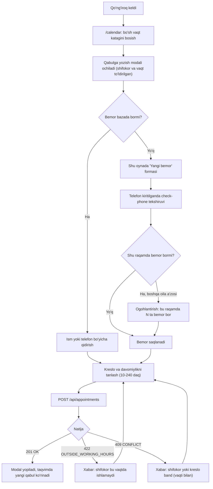
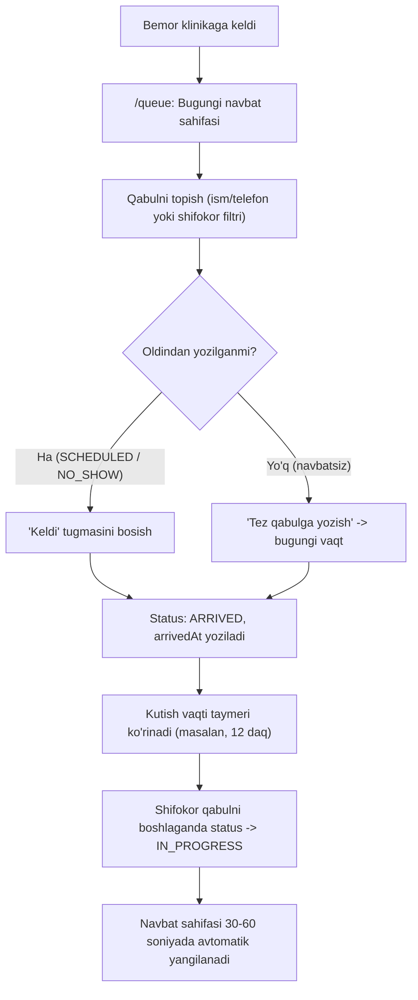
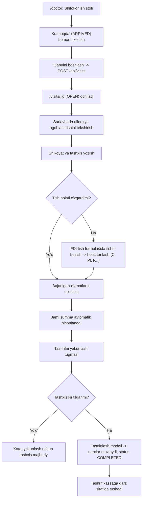
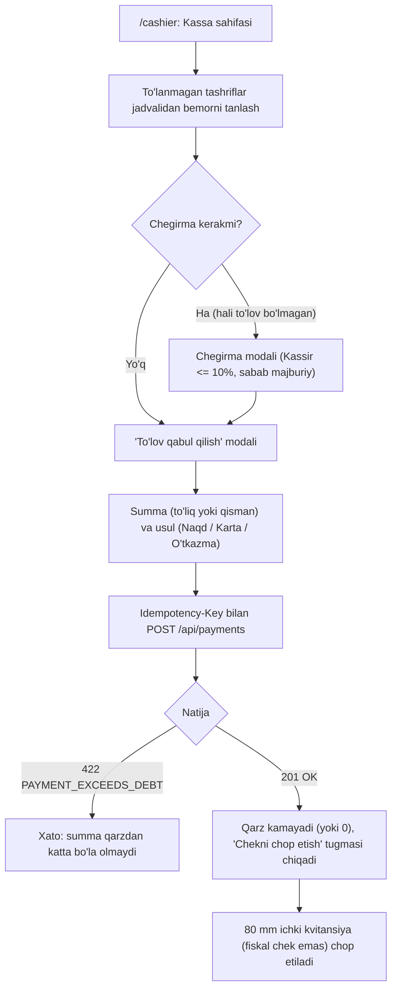
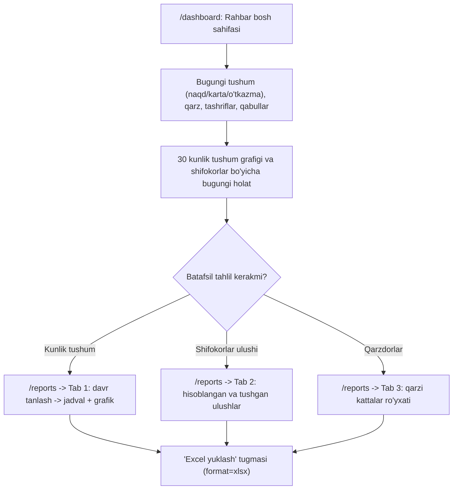

# F-2 Asosiy foydalanuvchi oqimlari (T-11)

> **Holat:** v1.0 (27.11.2026) · **Muallif:** Sanjar (Dizayner)  
> **Asos:** [arxitektura.md](../arxitektura.md) (7 va 8-bo'limlar), [sanjar-dizayner.md](../tz/sanjar-dizayner.md) (T-11).

Ushbu hujjat klinikadagi 5 ta asosiy kundalik jarayonni ekranlar kesimida ko'rsatadi.

---

## 1. Registrator: qo'ng'iroqdan qabulga yozishgacha

---

## 2. Registrator: bemor keldi va navbat

---

## 3. Shifokor: tashrifni boshlash, tish formulasi va yakunlash

---

## 4. Kassir: to'lov qabul qilish va 80 mm chek

---

## 5. Rahbar (ADMIN): kunlik nazorat va hisobotlar

